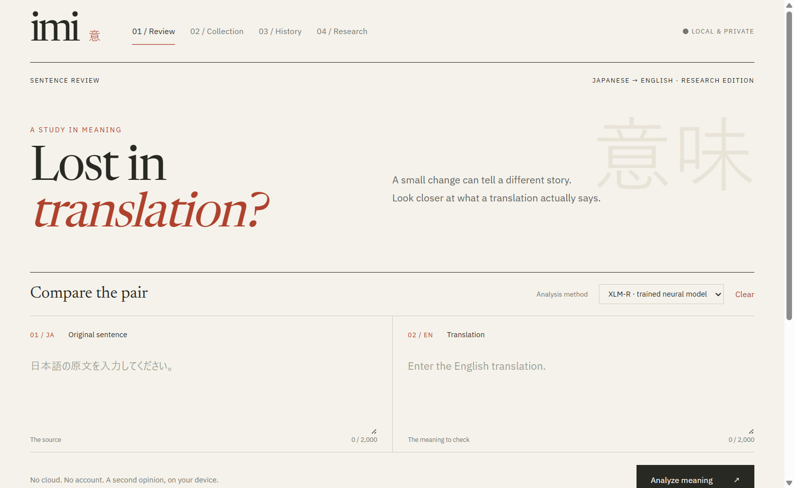

# Imi

A Windows desktop app for checking whether an English translation changes the meaning of a Japanese sentence. Imi compares the pair, flags possible semantic errors, and highlights the relevant text. Analysis runs locally.



## Current status

This is a research prototype. It has a trained XLM-R model, but it is **not reliable enough for real-world translation review** yet.

On the held-out test set, the selected model scored **0.148 F1 on natural machine-translation errors**, compared with **0.857 on authored examples**. The combined score of 0.776 hides that gap. The scope-supervision experiment did not show a convincing improvement over ordinary fine-tuning.

The calibration set also did not support a reliable positive decision threshold. Suspected changes therefore remain uncertain, with category findings available for review. A “meaning preserved” prediction is a fallible model judgment, not a guarantee.

The [model card](MODEL_CARD.md), [paper](docs/PAPER.md), and [full evaluation](research/results/final-evaluation.json) explain the results and failure cases.

## What the app does

- Compares Japanese originals with English translations.
- Predicts errors involving negation, modality, quantities, agents, time, conditions, entities, omissions, additions, and other meaning changes.
- Shows neural token highlights separately from linguistic rule evidence.
- Compares the neural model with the original feature classifier and scope/deadline rules.
- Imports CSV, JSON, or JSONL batches of up to 5,000 pairs and exports detailed results.
- Offers optional local history and feedback. Neither is uploaded or automatically added to training data.

[Watch the local demonstration](docs/Imi-local-demo.gif). The recording uses a preloaded model; it does not show cold-start time.

## Run from source

Install Node.js 24, then run:

```powershell
npm ci
npm start
```

Without neural assets, the app offers the feature classifier and rules. The neural weights and standalone runtime are not included in this repository. Follow the research setup below to build them locally.

## Train and evaluate

Use Python 3.12. Allow roughly 25 GB of disk space for dependencies and intermediate files. Training used an RTX 3070 Laptop GPU with 8 GB VRAM and 32 GB system RAM. Inference runs on CPU. Exact dependency versions are recorded in [environment-lock.txt](research/environment-lock.txt).

```powershell
python -m venv .venv
.venv/Scripts/python -m pip install torch==2.8.0 --index-url https://download.pytorch.org/whl/cu128
.venv/Scripts/python -m pip install -r research/requirements.txt
.venv/Scripts/python research/fetch_model.py
.venv/Scripts/python research/fetch_corpus.py
.venv/Scripts/python research/prepare.py
.venv/Scripts/python research/test_research.py
.venv/Scripts/python research/run_experiments.py
.venv/Scripts/python research/export_model.py research/checkpoints/ordinary-seed29
```

The experiment compares ordinary and scope-supervised XLM-R fine-tuning across three seeds, frozen contextual embeddings with logistic classifiers, the original cue classifier, and linguistic rules. Only the top four encoder layers are fine-tuned. Training uses natural MT with existing human annotations and separately labeled authored contrasts.

Training, validation, calibration, and test documents are separated. Checkpoint selection uses validation F1. The recorded deployment checkpoint is `ordinary-seed29`; choose a checkpoint from your own validation results before evaluating a reproduction.

`research/evaluate_final.py` evaluates the frozen models and refuses to overwrite an existing final report. Preserve the included report before a fresh reproduction. The test set has now been inspected: further tuning needs a new final test, not another claim of untouched evaluation on these examples.

See [the experiment protocol](research/PROTOCOL.md) and [annotation guide](research/ANNOTATION_GUIDE.md). Fixed seeds help reproduce the setup; GPU arithmetic can still vary across environments.

## Build for Windows

For the baseline-only app:

```powershell
npm ci
npm test
npm run smoke
$env:IMI_BASELINE_ONLY='1'
npm run dist
```

The Windows workflow builds this version. It does not download or redistribute research weights.

For a local neural build, first train and export the model, then package its inference worker:

```powershell
.venv/Scripts/python -m pip install pyinstaller==6.16.0
.venv/Scripts/python -m PyInstaller --noconfirm --onedir --name imi-inference --distpath research/runtime --workpath research/cache/pyinstaller --specpath research/cache --exclude-module torch --exclude-module transformers --exclude-module scipy --exclude-module sklearn --exclude-module onnx --collect-all onnxruntime --collect-all tokenizers research/infer.py
.venv/Scripts/python research/test_inference.py
$env:IMI_BASELINE_ONLY='0'
npm run smoke
npm run dist
```

The neural build bundles the worker, tokenizer, manifest, and verified FP32 ONNX graph. Two uint8 compression attempts failed numerical checks, so the graph remains about 1.11 GB. First launch is slower than warm inference. Builds are unsigned; a clean-Windows VM test has not yet been performed.

## Project layout

| Directory | Contents |
|---|---|
| `src/` | Electron app, renderer, local worker bridge, and rules |
| `research/` | Data preparation, model, training, calibration, and evaluation |
| `model/` | Baseline weights and neural deployment metadata |
| `tests/` | Desktop logic and regression tests |
| `docs/` | Paper source, demo, and verification notes |
| `output/pdf/` | Research paper and poster |

## Privacy

The desktop does not send sentence text to a server. Electron blocks remote HTTP/WebSocket requests, and the inference worker loads local files without a network client. Tests prohibit socket connections during Python inference; this is not an independent security audit.

History is off by default and limited to 100 saved results. Optional feedback stores the pair and prediction separately from research data. Both are plaintext files under the app's local user-data directory. See [SECURITY.md](SECURITY.md).

## Licensing

Imi code is MIT; bundled fonts retain their OFL notices. **The natural corpus annotations are CC BY-NC-SA 4.0, and upstream excludes rights to the source documents.** The research weights and neural executable are not offered here as MIT-licensed or commercially cleared downloads. Read [DATA_LICENSES.md](research/DATA_LICENSES.md) before redistributing them.

## Next steps

The priority is better natural-error data and independent bilingual annotation, followed by a fresh multi-domain test set. Other open work includes an external QE comparison, annotation agreement, explanation-faithfulness evaluation, and clean-machine testing. Shared surface templates in the authored examples mean their high scores do not rule out memorization.
